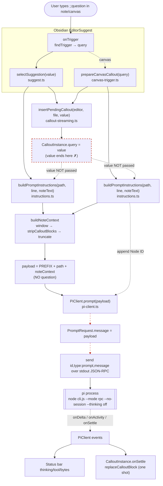

# inline-pi — Architecture & Prompt Data-Flow (T56)

A visual architecture review of the prompt path, produced so the #10 fix is
grounded in the real data-flow and not a guess. Companion to the #10 issue
("put the note content in the prompt directly instead of instructing the
agent to read the file") and the T55 follow-up.

> **On Eraser.** T56 named Eraser's codebase-diagram feature. Eraser is a
> hosted service (eraser.io) — every path to it (web app, API, VS Code ext)
> hits their servers, and the codebase-diagram feature reads a connected
> repo over OAuth. Bawa ruled it out on a no-cloud / no-dependencies
> criterion, so the review was done the local, dependency-free way instead:
> a hand-built Mermaid diagram (renders in Obsidian + GitHub, lives in the
> repo) plus the plain-text data-flow trace below. For a 13-file plugin
> where every file in the prompt path was read, this is higher-fidelity
> than a cloud AI guess and needs no repo connection or token.

## Component map

```
src/
├── main.ts            Plugin entry; owns the single shared PiClient + AbortWatcher;
│                      wires PiClient events → status bar. Holds no prompt logic.
├── suggest.ts         Markdown path. EditorSuggest: onTrigger → selectSuggestion(value)
├── canvas-trigger.ts  Canvas path. InlinePiCanvasSuggest → prepareCanvasCallout(query)
├── instructions.ts    buildPromptInstructions(notePath, cursorLine, noteText)
│                      = INSTRUCTIONS_PREFIX + pathLine + buildNoteContext(...)
│                        buildNoteContext = window(±50) → stripCalloutBlocks → truncate(8k)
├── callout-streaming.ts  insertPendingCallout(editor, file, query) → CalloutInstance
│                         (T42: callout is static until settle; onDelta is a no-op)
├── callout.ts         buildCalloutHeader, replaceCalloutBlock, findCalloutBlock
├── pi-client.ts       PiClient.prompt(message) → PromptRequest → send JSON-RPC over stdout
│                      to a spawned `node cli.js --mode rpc --no-session --thinking off`
├── abort-watcher.ts   Registers pending callouts; aborts the run if the header is edited
├── canvas.ts          findCanvasNodeIdForEditor, deliverCanvasReply
├── settings.ts, types.ts, debug-log.ts, index.ts
```

## The prompt data-flow (the #10 trace)

There are **two trigger paths** (markdown + canvas). Both share the same
shape, and both have the **same bug**: the user's `query` reaches the
callout but never reaches pi.

### Markdown path — `suggest.ts → instructions.ts → pi-client.ts → pi`

1. **Trigger.** User types `;;weather report for Berlin`. Obsidian calls
   `InlinePiSuggest.onTrigger(cursor, editor, file)`. `findTrigger` scans
   the line before the cursor for the trigger phrase; returns
   `{ triggerIndex, query }` where **`query = "weather report for Berlin"`**.
2. **Pick.** `getSuggestions` returns `[context.query]`. User accepts;
   `selectSuggestion(value, evt)` runs with **`value = "weather report for Berlin"`**.
3. **Callout.** `insertPendingCallout(editor, file, value)` creates a
   `CalloutInstance` holding `query = value`. It writes the pending header
   `> [!claude] weather report for Berlin` into the note. **`value` lives in
   the callout from here on — it is NOT carried forward into the prompt.**
4. **Prompt payload.** `buildPromptInstructions(file.path, cursorLine, noteText)`
   is called. Note the argument list: **no `value`**. It returns:
   ```
   INSTRUCTIONS_PREFIX
   Note: `<path>` (cursor line N)

   The note you're in (cursor at line N):
   <±50-line window, prior callouts stripped, truncated to 8k>
   ```
   The user's question is **absent** from this string.
5. **Enqueue.** `piClient.prompt(payload, { onSettle })`. `payload` becomes
   `PromptRequest.message`.
6. **Transport.** `dispatchNext` → `ensureSpawned` (spawn `node cli.js --mode rpc`)
   → `send({ id, type: "prompt", message: req.message })`. The exact
   `message` from step 4 is written to pi's stdin as one JSON-RPC line.
7. **pi.** pi receives `message` = instructions + note context. **No
   question.** It responds to "here is a note, you are connected to a vault"
   — typically by reading the file or producing a generic reply, never the
   asked Q&A. This is the #10 functional break: code is green, build passes,
   but the run is context-only.

### Canvas path — `canvas-trigger.ts` (same bug)

`prepareCanvasCallout` mirrors the markdown path:
`insertPendingCallout(editor, file, query)` (query → callout), then
`buildPromptInstructions(filePath, cursor.line, noteText)` (**no `query**`),
then appends `\nNode ID: ${nodeId}`, then `piClient.prompt(messageWithNodeId)`.
Same drop: `query` reaches the callout, not pi.

## Diagram



The two **red dashed** lines are the #10 miss: `value`/`query` is captured by
the callout but never threaded into `buildPromptInstructions`, so the message
pi receives has instructions + note context and no question.

## The fix (grounds T55)

Pass the query into the prompt payload as a labeled Question section, in
both paths:

- `instructions.ts`: `buildPromptInstructions(notePath, cursorLine, noteText, question?: string)`
  appends `\n## Question\n\n${question}\n` when `question` is provided.
- `suggest.ts`: `buildPromptInstructions(file.path, cursorLine, noteText, value)`.
- `canvas-trigger.ts`: `buildPromptInstructions(filePath, cursor.line, noteText, query)`.

The question is the user's `value`/`query` — already in hand at trigger time,
already shown in the callout header. Threading it one more hop into the
payload is the whole fix; everything else in #10 (note context, callout
stripping) is already on disk from T55 and is correct.

## Related

- **#10** — the issue this traces. Structural fix for #9 (callout mimicry) +
  the actionable side of #5 (quick Q&A vs full agent).
- **T55** — uncommitted on-disk changes (10 files) that did the note-context
  half of #10 but missed the query. Blocked on this review; unblock by
  adding the `question` argument above.
- **#8** — multi-turn mash; mostly moot for the common case once #10 lands
  (one turn, nothing to mash), stays open for explicit-tool prompts.
- **#7** — session continuation across reloads; independent of #10.
